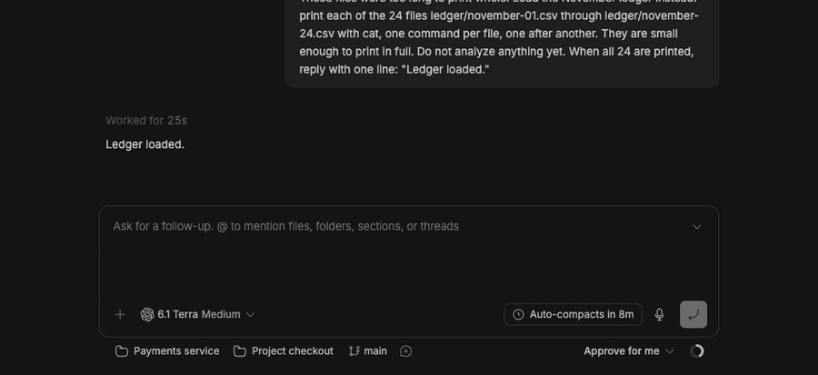
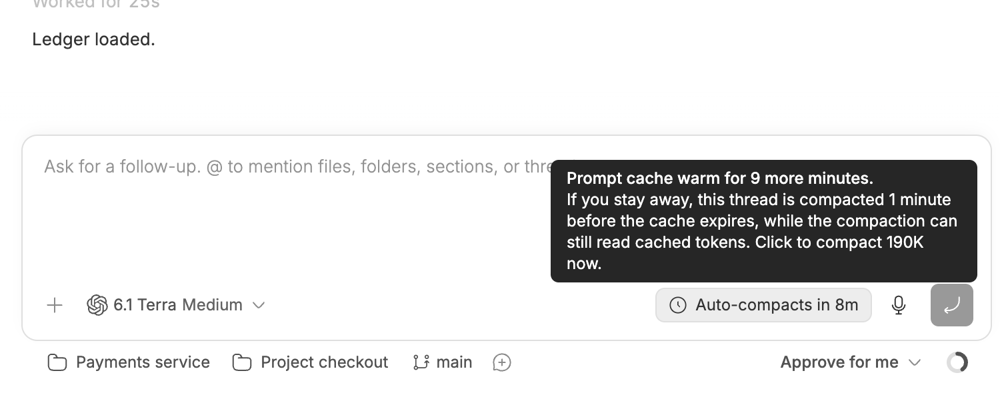
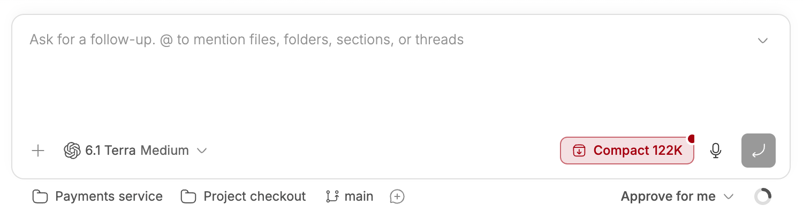
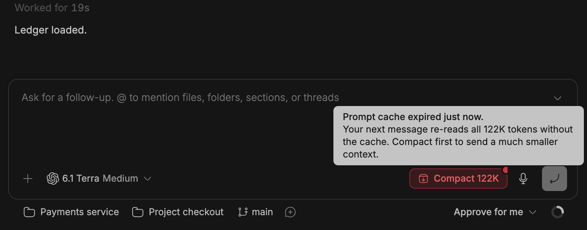
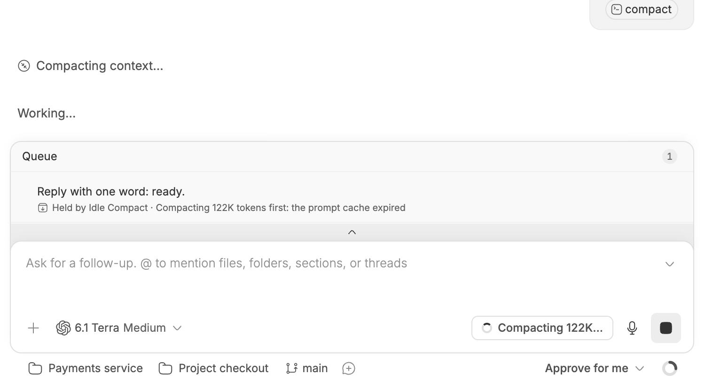
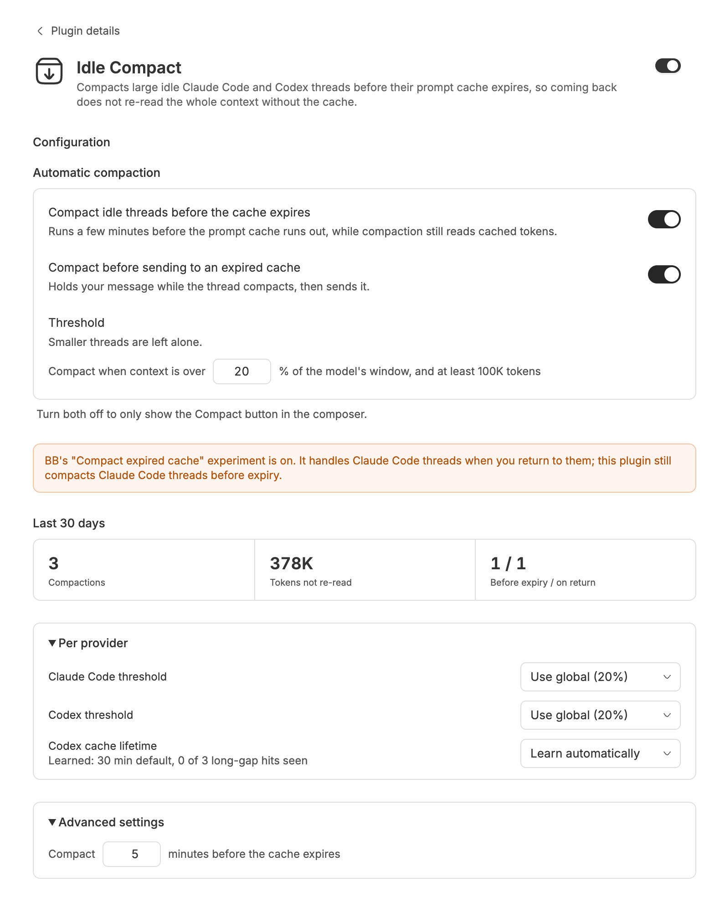
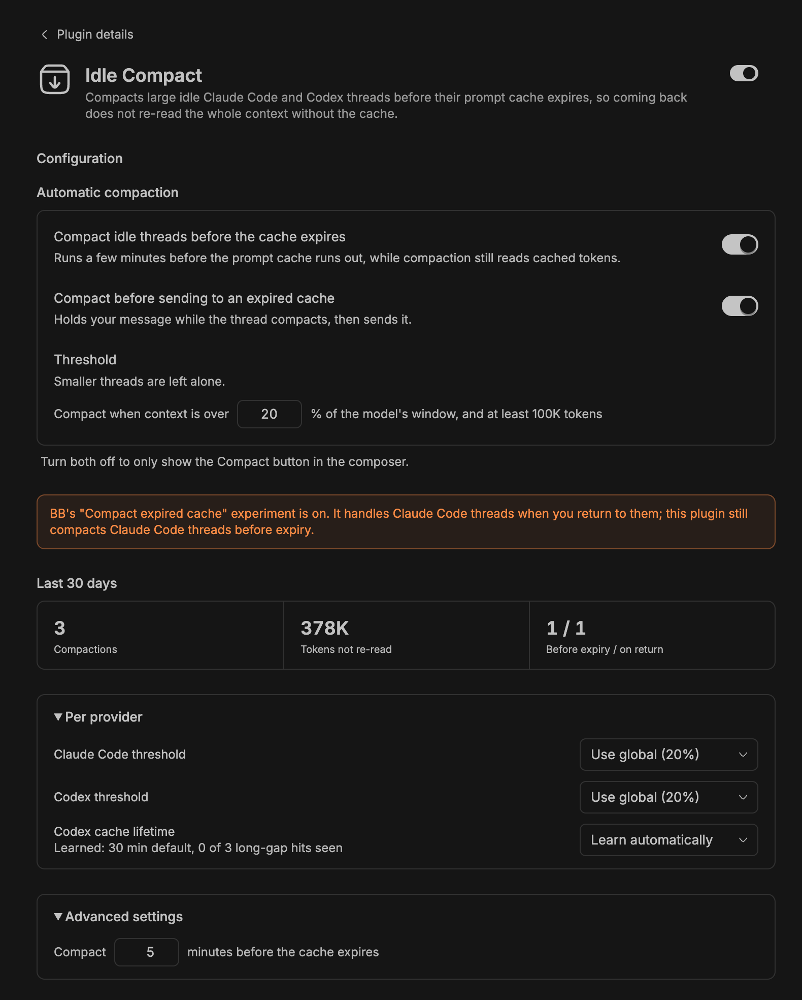

# Idle Compact

[](https://github.com/ysskrishna/bb-idle-compact/actions/workflows/ci.yml)
[](https://github.com/ysskrishna/bb-idle-compact/releases)
[](LICENSE)
[](https://ysskrishna.space)

A [BB](https://getbb.app) plugin that compacts large idle Claude Code and Codex threads before their prompt cache expires, so coming back to a thread does not re-read its whole context without the cache.

Providers cache a conversation for a limited time: Claude Code reports 5 minutes or 1 hour; Codex does not report one, and the plugin assumes 30 minutes. Come back after that, and your next message re-reads every token of the context at full price, or from your plan's usage. Idle Compact compacts the thread just before the cache runs out, while compaction can still read cached tokens, and tells you in the composer what it is about to do.



The GIF records a disposable Codex thread in BB 0.50.1, in two parts joined with one cut, with a short test cache lifetime: **Auto-compacts → Compact → Compacting → Compacted**. [Capture details](docs/screenshots/README.md).

## Features

| Feature | What it does |
| --- | --- |
| **Compact before expiry** | An idle thread above your threshold is compacted a few minutes before its prompt cache expires. On by default, 5 minutes before. |
| **Compact before sending** | If the cache already expired, the message you send waits while the thread compacts, then sends. On by default. |
| **Composer pill** | "Auto-compacts in 23m" while the cache is warm, "Compact 412K" in red once it expired, "Compacting" while it runs, and "Compacted 412K → 68K" until your next message. Click the first two to compact now. |
| **Threshold** | A thread qualifies when its context is over a percentage of the model's window (20% by default) and at least 100K tokens. Below 100K, compacting costs about as much as it saves. |
| **Stats** | The settings page shows the last 30 days: compactions, tokens not re-read, and compactions before expiry versus on return. |

Compaction uses BB's own `/compact`, the same as the composer command, and shows in the thread timeline. It keeps a summary, not the full history. Nothing shows below the threshold, while a turn is running, or on providers the plugin does not support.

**Providers.** Claude Code reports its cache lifetime. Codex does not, so the plugin starts at 30 minutes and learns a longer one after three cache hits beyond 30 minutes. When BB's own `compactExpiredCache` experiment is on, BB handles Claude Code threads when you return to them; Idle Compact still compacts them before expiry. Cursor is not supported: BB cannot compact Cursor threads or read their usage.

## Installation

Requires **BB 0.50.x**. The release badge above reflects published GitHub Releases; there is no release yet.

```sh
bb plugin install git:github.com/ysskrishna/bb-idle-compact@main
```

BB shows the source for confirmation before installing it. The plugin ID is `bb-idle-compact`. Turn the plugin off or on with the switch on its page, **Settings > Idle Compact**.

## See it in action

<details>
<summary><b>Before the cache expires</b></summary>

The pill counts down to the automatic compaction. Hover it for details; click it to compact now.




</details>

<details>
<summary><b>After the cache expired</b></summary>

If nothing compacted the thread, the pill turns red. Your next message would re-read the whole context without the cache.





Send a message anyway, and Idle Compact holds it while the thread compacts, then sends it.



</details>

<details>
<summary><b>Compacting and compacted</b></summary>


</details>

<details>
<summary><b>Settings</b></summary>

Open **Settings > Idle Compact**. Turn both automatic switches off to only show the Compact button. Per-provider thresholds and the Codex cache lifetime are under **Per provider**; the margin before expiry is under **Advanced settings**.





</details>

## Development

<details>
<summary><b>Build, check, and capture the demo</b></summary>

```sh
git clone https://github.com/ysskrishna/bb-idle-compact.git
cd bb-idle-compact
npm ci
npm run check
```

The [development guide](docs/development.md) covers the isolated scratch BB, the RPC smoke test, and how the README media were captured. Tag-based releases follow [AGENTS.md](AGENTS.md#tag-based-releases).

</details>

## Project links

- [Releases](https://github.com/ysskrishna/bb-idle-compact/releases) and [issues](https://github.com/ysskrishna/bb-idle-compact/issues)
- [Security policy](SECURITY.md)
- [BB Marketplace plans](docs/marketplace.md)

## Built and maintained by

Idle Compact is built and maintained by:

| | Name | GitHub | Role |
| --- | --- | --- | --- |
|  | **Y. Siva Sai Krishna** | [@ysskrishna](https://github.com/ysskrishna) | Creator |

## Changelog

See [CHANGELOG](CHANGELOG.md) for release history and unreleased changes.

## Support

If you find this project helpful:

- ⭐ Star the repository
- 🐛 [Report issues](https://github.com/ysskrishna/bb-idle-compact/issues)
- 🔀 Submit pull requests
- 💝 [Sponsor on GitHub](https://github.com/sponsors/ysskrishna)

## License

MIT © [Y. Siva Sai Krishna](https://github.com/ysskrishna) - see [LICENSE](LICENSE) for details.

---

<p align="left">
  <a href="https://github.com/ysskrishna">Author's GitHub</a> •
  <a href="https://linkedin.com/in/ysskrishna">Author's LinkedIn</a> •
  <a href="https://ysskrishna.space">Author's site</a> •
  <a href="https://github.com/ysskrishna/bb-idle-compact/releases">Releases</a> •
  <a href="https://github.com/ysskrishna/bb-idle-compact/issues">Report Issues</a>
</p>
